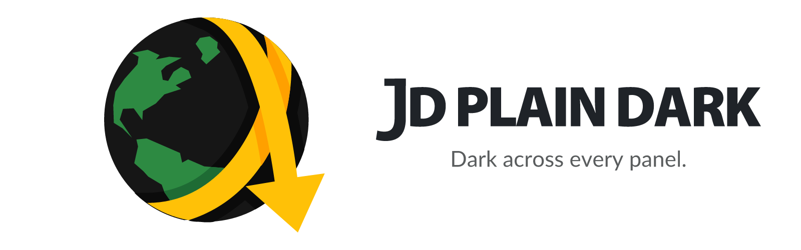
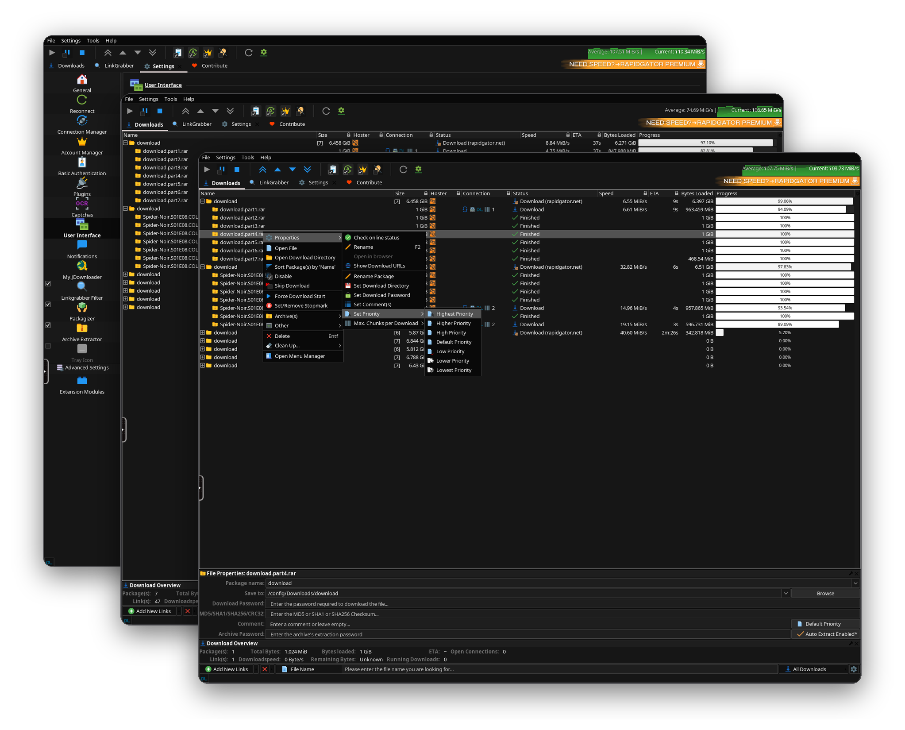

<p align="center">
  <picture>
    <source media="(prefers-color-scheme: dark)" srcset=".github/assets/banner-dark.png">
    
  </picture>
</p>

<p align="center">
  <a href="https://github.com/junkerderprovinz/jd-plain-dark/actions/workflows/lint.yml"></a>&nbsp;
  <a href="https://github.com/junkerderprovinz/jd-plain-dark/releases/latest"></a>&nbsp;
  <a href="https://github.com/junkerderprovinz/jd-plain-dark/releases"></a>&nbsp;
  <a href="#5-install"></a>&nbsp;
  <a href="https://jdownloader.org"></a>&nbsp;
  <a href="LICENSE"></a>
</p>

<br>

<p align="center">
A fully dark <b>JD Plain</b> theme for <b>JDownloader 2</b>: a monochrome IBM Carbon (#161616)
dark across the <i>whole</i> interface (download list, link grabber <b>and</b> settings, not just
the menu bar). It uses JDownloader's own colour configuration, so there is <b>no patched JAR and
no Java agent</b>, just one config file.
</p>

<br>

<p><a id="table-of-contents" href="#table-of-contents"><picture><source media="(prefers-color-scheme: dark)" srcset=".github/assets/sections/table-of-contents-dark.svg"></picture></a></p>

1. [Download](#1-download)
2. [Support](#2-support)
3. [What it does](#3-what-it-does)
4. [Screenshots](#4-screenshots)
5. [Install](#5-install)
6. [How it works](#6-how-it-works)
7. [Event Scripter fix (optional)](#7-event-scripter-fix-optional)
8. [Uninstall](#8-uninstall)
9. [Credits](#9-credits)
10. [License](#10-license)
11. [How AI is used here](#11-how-ai-is-used-here)

<br>

<p><a id="1-download" href="#1-download"><picture><source media="(prefers-color-scheme: dark)" srcset=".github/assets/sections/1-download-dark.svg"></picture></a></p>

<!-- download-buttons: written by scripts/gen_download_buttons.py -->
<p align="center">
  <picture><source media="(prefers-color-scheme: dark)" srcset=".github/assets/sections/group-server-dark.svg"></picture>
</p>
<p align="center">
  <a href="https://ca.unraid.net/apps/jdownloader-18m0vwh17mexzh"></a>
  &nbsp;
  <a href="https://github.com/junkerderprovinz/jd-plain-dark/releases/latest"></a>
</p>
<br>
<p align="center">
  <picture><source media="(prefers-color-scheme: dark)" srcset=".github/assets/sections/group-desktop-dark.svg"></picture>
</p>
<p align="center">
  <a href="https://github.com/junkerderprovinz/jd-plain-dark/releases/latest"></a>
  &nbsp;
  <a href="https://github.com/junkerderprovinz/jd-plain-dark/releases/latest"></a>
  &nbsp;
  <a href="https://github.com/junkerderprovinz/jd-plain-dark/releases/latest"></a>
</p>
<!-- /download-buttons -->

<br>

<p align="center">
  <a href="https://github.com/junkerderprovinz/knightloader"></a>
</p>

<br>

<p><a id="2-support" href="#2-support"><picture><source media="(prefers-color-scheme: dark)" srcset=".github/assets/sections/2-support-dark.svg"></picture></a></p>

<p align="center">
A one-knight job: I build it, keep it running, work through the issues and add what people ask for, until nothing is missing. It is free, with no accounts, no telemetry, no ads and no paid tier. No asterisk anywhere. Nothing readable ever leaves your own walls. Forged on evenings and weekends, with heart and stubbornness.
</p>

<p align="center">
If it has earned a place on your server or computer, toss a coin to your knight: it helps cover the costs and keeps the project alive. It also makes this knight's heart beat a little faster. Three ways below, whichever suits you.
</p>

<!-- give-buttons: written by scripts/gen_download_buttons.py -->
<p align="center">
  <a href="https://buymeacoffee.com/junkerderprovinz"></a>
  &nbsp;
  <a href="https://www.paypal.com/donate/?hosted_button_id=76FVV52TKXTUS"></a>
  &nbsp;
  <a href="https://junkerderprovinz.github.io/junkerderprovinz/"></a>
</p>
<!-- /give-buttons -->

<br>

<p><a id="3-what-it-does" href="#3-what-it-does"><picture><source media="(prefers-color-scheme: dark)" srcset=".github/assets/sections/3-what-it-does-dark.svg"></picture></a></p>

JDownloader 2 ships no proper dark mode: enable a dark Look & Feel and the *chrome*
(menu bar, toolbar, headers, scrollbars) goes dark, but JD's custom content areas (the
**download list**, the **link grabber** and the **Advanced Settings** table) stay light.

**JD Plain Dark** fixes that. It is the **JD Plain** flat icon set rendered in a neutral
IBM Carbon (`#161616`) dark, applied through the colour keys JDownloader reads itself, so the
**entire** UI is dark and consistent. Functional accents stay (green speed graph, muted
red/amber for failed downloads and accounts).

- Works on **Windows, macOS and Linux** (it is just JD config).
- **No patched `flatlaf.jar`, no Java agent:** survives JDownloader self-updates.
- **Ad-free too:** the installer also switches off JDownloader's built-in advertisements (the *"Become premium user"* banner, the premium-alert column nags, special-deal popups), so the GUI stays clean and the download graph keeps its full height. Ads only. The Donate button and all functional settings are untouched.
- One file to install, one file to remove.

<br>

<p><a id="4-screenshots" href="#4-screenshots"><picture><source media="(prefers-color-scheme: dark)" srcset=".github/assets/sections/4-screenshots-dark.svg"></picture></a></p>

<p align="center">
  
</p>

<p align="center"><sub>The whole UI in monochrome IBM&nbsp;Carbon <code>#161616</code>: download list, context menu and settings.</sub></p>

<br>

<p><a id="5-install" href="#5-install"><picture><source media="(prefers-color-scheme: dark)" srcset=".github/assets/sections/5-install-dark.svg"></picture></a></p>

### Option A: download & run the installer (recommended)

1. Download `jd-plain-dark-vX.Y.Z.zip` from the [latest release](https://github.com/junkerderprovinz/jd-plain-dark/releases/latest) and unzip it.
2. **Close JDownloader.** It rewrites its own config on shutdown, which would undo the
   install.
3. Run the installer for your OS:
   - **Windows:** double-click **`install/install.bat`** (recommended). It keeps the
     window open and, if it can't find JDownloader automatically, **asks you for the
     folder**. (Right-click `install/install.ps1` → *Run with PowerShell* also works.)
   - **Linux / macOS:** `sh install/install.sh "/path/to/JDownloader"`
     (the folder that contains `cfg`). Without an argument it auto-detects, and prompts
     if it can't.
4. **Start JDownloader.**

The installer copies `FlatDarkLaf.json` into JD's `cfg/laf/` and selects the
`FLATLAF_DARK` Look & Feel.

### Option B: manual (one file)

1. Close JDownloader.
2. Copy `theme/cfg/laf/FlatDarkLaf.json` into your JDownloader folder under `cfg/laf/`.
3. On Windows, open the copied file and add `"windowdecorationenabled": true` so the title
   bar turns dark as well.
4. Start JDownloader, open **Settings → Advanced Settings**, search for
   **`lookandfeeltheme`** and set it to **`FLATLAF_DARK`**.
5. **Restart JDownloader.**

> **Where is the theme switch?** JDownloader 2 has no *Look & Feel* entry in the normal
> settings panels. It lives in **Settings → Advanced Settings** only, under
> `lookandfeeltheme`. If that key offers no `FLATLAF_*` value, your JDownloader core is
> too old: let it update (**Help → Check for Updates**) and try again.

### Installed on Windows before v1.2.2? Run it again

Up to and including v1.2.1 the Windows installer only applied the settings when it happened
to run on PowerShell 7. `install.bat` starts Windows PowerShell 5.1 on a stock machine, so
for most people it copied the theme file, printed `Done`, and changed nothing else. The UI
stayed light and the note it printed pointed at a menu JDownloader does not have
([#11](https://github.com/junkerderprovinz/jd-plain-dark/issues/11)).

If that was you, nothing is broken and there is nothing to clean up: download
[v1.2.2 or later](https://github.com/junkerderprovinz/jd-plain-dark/releases/latest), close
JDownloader, run the installer again, and start JDownloader. Linux and macOS were never
affected.

<br>

<p><a id="6-how-it-works" href="#6-how-it-works"><picture><source media="(prefers-color-scheme: dark)" srcset=".github/assets/sections/6-how-it-works-dark.svg"></picture></a></p>

JDownloader stores per-Look-&-Feel colours in `cfg/laf/FlatDarkLaf.json` using `colorfor*`
keys (e.g. `colorfortablepackagerowbackground`). JD's own renderer reads these, including the
ExtTable behind the download list, link grabber and settings, so setting them dark colours the
content areas too, not only the Swing chrome. `iconsetid: flat` selects the JD Plain icons.
JD only reads its own keys from this file and drops everything else, so raw FlatLaf keys such
as `ProgressBar.selectionForeground` have no effect here. That is why the percentage sits next
to the progress bar (`progresscolumntextposition: RIGHT`): JD fills the bar in the table's
text colour, and FlatLaf's light label on top of it could not be read.

On Windows the installer also sets `windowdecorationenabled: true` in the same file. JD then
lets FlatLaf draw the title bar, which follows the theme, instead of the native Windows title
bar, which stays light. Linux and macOS keep their native window decorations.

The installer also writes two things into `cfg/org.jdownloader.settings.GraphicalUserInterfaceSettings.json`:
`lookandfeeltheme: FLATLAF_DARK` (so the dark L&F is active) and a handful of `false` flags that
switch off JDownloader's built-in advertisements (`bannerenabled`, the `premiumalert*` columns,
`specialdeals*`, the status-bar premium button). Ads only. Nothing functional is changed.

That is the whole trick: no bytecode patching, no `-javaagent`. Because it is plain
configuration, JD's automatic updates don't break it.

<br>

<p><a id="7-event-scripter-fix-optional" href="#7-event-scripter-fix-optional"><picture><source media="(prefers-color-scheme: dark)" srcset=".github/assets/sections/7-event-scripter-fix-optional-dark.svg"></picture></a></p>

The theme is config-only and needs nothing else. This section is **only** for people who use
the **Event Scripter** extension and hit a separate JDownloader bug: on any FlatLaf dark Look &
Feel (this theme *or* JD's own `flatlaf-themes` dark), the Event Scripter **script editor won't
open**. Clicking **edit** or **Add** does nothing. That is a JDownloader bug, not a theme bug
(the stock dark theme triggers it too), so fixing it needs a small optional add-on rather than a
config key.

`jd-es-fix.jar` is a tiny, fail-safe `-javaagent` that null-guards the two code paths involved.
Download it from the [latest release](https://github.com/junkerderprovinz/jd-plain-dark/releases/latest)
and point JDownloader's JVM at it, e.g.:

```
JAVA_TOOL_OPTIONS=-javaagent:/full/path/to/jd-es-fix.jar
```

Full instructions (per-OS setup, building it yourself, and what it patches) are in
[docs/event-scripter-fix.md](docs/event-scripter-fix.md). If you don't use Event Scripter, ignore
this entirely. The theme stays pure config and needs no agent.

<br>

<p><a id="8-uninstall" href="#8-uninstall"><picture><source media="(prefers-color-scheme: dark)" srcset=".github/assets/sections/8-uninstall-dark.svg"></picture></a></p>

Close JDownloader, delete `cfg/laf/FlatDarkLaf.json` from your JDownloader folder, then start it
again and set `lookandfeeltheme` back to `DEFAULT` under **Settings → Advanced Settings**.
Restart JDownloader.

<br>

<p><a id="9-credits" href="#9-credits"><picture><source media="(prefers-color-scheme: dark)" srcset=".github/assets/sections/9-credits-dark.svg"></picture></a></p>

The technique of overriding JDownloader's native `colorfor*` colour config to reach the content
areas was inspired by the community **Material Darker** theme. The colours here are our own
(IBM Carbon monochrome) and no Material Darker code or assets are included. Licensed MIT.

Derived from the dark theme built into the [JDownloader-for-Unraid container](https://github.com/junkerderprovinz/jdownloader).

<br>

<p><a id="10-license" href="#10-license"><picture><source media="(prefers-color-scheme: dark)" srcset=".github/assets/sections/10-license-dark.svg"></picture></a></p>

**Copyright (C) 2026 Junker der Provinz.**

JD Plain Dark is free software under the **GNU Affero General Public License v3.0** (AGPL-3.0); see [LICENSE](LICENSE). You may run, study, share and modify it. If you distribute it, or run a modified version as a network service, you must release your source under the same AGPL-3.0 terms and keep the existing copyright and attribution notices intact.

**Name and branding are not licensed.** The AGPL covers the source code only. "JD Plain Dark", its logo and its branding remain reserved: a fork or derivative must use its own distinct name and branding, and may not present itself as JD Plain Dark. This keeps it unambiguous which project is the original.

<br>

<p><a id="11-how-ai-is-used-here" href="#11-how-ai-is-used-here"><picture><source media="(prefers-color-scheme: dark)" srcset=".github/assets/sections/11-how-ai-is-used-here-dark.svg"></picture></a></p>

One knight builds this, and AI is one of the tools I work with, the same way I work with an editor or a compiler. It helps me write code and documentation and it checks my work, and that saves me a good many evenings. It does not make the decisions, though. I read and understand everything before it ships, and if something here breaks, that is on me and not on the tool.

You do not have to take my word for it. The code is open and every release note is written by hand. The issue tracker shows how problems actually get handled, including the ones I got wrong the first time. If you find something that is not right, open an issue and I will look at it.

<br>

Issues and suggestions: [GitHub Issues](https://github.com/junkerderprovinz/jd-plain-dark/issues).
